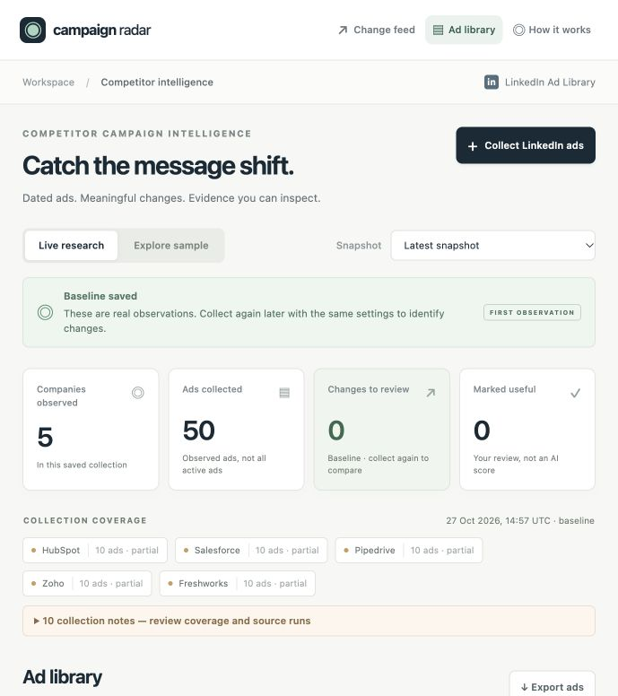

# Campaign Radar

**An evidence-first competitor campaign intelligence workspace for GTM teams.**

[Open the live portfolio demo](https://vinaynaik432-debug.github.io/competitor-campaign-intelligence/) · [Source repository](https://github.com/vinaynaik432-debug/competitor-campaign-intelligence)

Track public LinkedIn ads from **HubSpot, Salesforce, Pipedrive, Zoho and Freshworks**, save dated observations, and review changes with the original copy and source links beside them. The initial watchlist focuses on CRM and adjacent sales software so the research has a useful competitive context.

This is a local Python application with a browser dashboard and a public GitHub Pages demo. The public demo includes saved excerpts from a real five-company collection and a clearly labelled walkthrough using five **fictional** CRM companies. Fresh research runs through the local application with your own Apify key.



### First live validation · 27 October 2026

The initial test collected **50 ads: 10 per company**, with all 50 advertiser IDs verified against the watchlist and all 50 detail records available. The provider reported **US$0.067** total run cost. Six ads exposed an external-link candidate. Four of those ads resolved to the same public page; the other two stopped at LinkedIn link gateways and are marked unavailable. The remaining ads have no inferred destination.

This is a **baseline**, with zero live change claims. The ad limit was reached for every company, so coverage is explicitly partial. The public demo contains a sanitized selection of fields with short ad excerpts and source links. Full local captures, private run IDs, billing records and credentials are excluded. These results validate collection and storage, not GTM impact or campaign performance.

## What you can do

- Collect a bounded sample of 5, 10 or 20 LinkedIn ads per company.
- Browse ad copy, format, dates, library links, available disclosures and linked pages.
- Save snapshots in SQLite and compare compatible collection scopes.
- Review first-observed ads, offer wording and messaging changes, and successfully captured page-text changes.
- Filter findings by company and change type; search ad copy.
- Mark a finding **Useful**, **Not useful** or **Acted on** and export findings or ads as CSV.
- Inspect collection coverage, failed companies, provider run links and the local budget ledger.

The first live collection establishes a baseline. A later comparable collection enables change detection. No live campaign history is invented to fill that gap.

## Run locally

Requires **Python 3.9+**. There are no third-party Python dependencies, Node build steps or database services.

```bash
git clone https://github.com/vinaynaik432-debug/competitor-campaign-intelligence.git
cd competitor-campaign-intelligence
python3 app.py
```

Open **http://127.0.0.1:8920/**. On macOS you can also run `Start Dashboard.command`. If the port is in use, run `python3 app.py --port 8921`.

The sample walkthrough works without an API key or internet connection. It has two illustrative snapshots and demonstrates the review workflow, including a failed collection. It is **not a case study of the real companies on the live watchlist**.

### Collect real LinkedIn ads

1. Open the collection panel and enter your own Apify token.
2. Connect it. The server checks access without starting a paid Actor.
3. Select the ad limit and whether to capture available public page links.
4. Start a collection explicitly; follow its progress in the dashboard.
5. Review the saved baseline. Run again on a later date with the same settings to compare observations.

The token stays in server memory. It is not written to SQLite, browser storage, exports or the repository. Disconnect clears the saved token; an already-running collection retains its in-flight copy until it finishes. Restarting the application clears credentials. Do not paste keys into chat, source files or Git commits.

## Collection scope and cost

The pinned provider is [`oski/linkedin-ad-library-scraper`](https://apify.com/oski/linkedin-ad-library-scraper), build **0.1.8**, verified on 27 October 2026. It is a third-party Actor, not an official LinkedIn API. Each company is searched by its verified numeric LinkedIn company ID.

| Setting | Initial value |
| --- | --- |
| Companies | HubSpot, Salesforce, Pipedrive, Zoho, Freshworks |
| Date window | Last 30 days |
| Country filter | All available countries |
| Ad limit | 10 per company by default |
| Provider allowance | US$0.10 per company run |
| Development allowance | US$5 cumulative for this project |
| Public page capture | At most two new URLs per company per collection |

At the published highest per-ad tier, 50 ads plus five run starts are approximately **US$0.085** before any ancillary account charges. This is an estimate, not a billing guarantee; the dashboard shows the provider's actual reported run cost. See the versioned [provider specification](docs/provider-spec.json) for sources and field limitations.

Before each paid POST, the application reserves US$0.10 in an atomic SQLite transaction. A complete five-company collection requires US$0.50 of unallocated allowance. Each start includes Apify's `maxTotalChargeUsd`; the response must acknowledge that cap. Paid starts are never automatically retried.

Reservations are deliberately **not automatically released**, even after a cheap successful run. The dashboard separates reported spend from unused reserved allowance. This is conservative: it protects the US$5 development limit when requests or billing responses are uncertain. Do not delete `data/` to reset the ledger during testing. The limit covers Actor runs started by this project; it is not an account-wide Apify spending limit.

## How change detection works

```text
Exact company IDs → Apify run → raw evidence + normalized ads
                                      ↓
                        dated local SQLite snapshot
                                      ↓
                compare with previous compatible snapshot
                                      ↓
              evidence cards → human review → experiment backlog
```

| Finding | Evidence required | Interpretation |
| --- | --- | --- |
| First observed | An ad ID present now and absent in the earlier saved sample | First seen by this project, not necessarily newly launched |
| Offer wording changed | Same ad ID; different offer-related text | Deterministic keyword flag for human review |
| Messaging changed | Same ad ID; different headline, body or CTA | Observed creative-copy difference |
| Landing-page copy changed | Two successful captures of the same canonical URL | Text changed; personalization or experiments may explain it |
| Previously collected ad not observed | Both collections explicitly complete, with matching scope | Absence in these observations; never proof an ad stopped |

The current Actor does not provide a trustworthy completeness indicator. **All live collections are therefore labelled partial samples**, even when the Actor succeeds. Absence alerts are suppressed for these samples. The fictional demo includes a complete-coverage example to demonstrate the more general comparison rule.

Changes to date filters, ad limits, countries, provider build or page-capture settings start a new comparable baseline. Whitespace-only text changes are ignored. Tracking parameters such as `utm_*` are stripped for page identity; content-changing query parameters are preserved.

Creative text may mention “sales teams” or “CFOs”. These are **audience words in the message**, not confirmed targeting. Available provider targeting and EU transparency disclosures are retained separately. Prices, free trials, demo offers and similar phrases are found with deterministic English-language rules. There is **no LLM in this version**, so there are no model-generated claims, hallucinated evidence or AI API costs.

### Linked-page capture limitations

The provider's documented output has no guaranteed landing-page URL field. The application uses an explicit destination when present, or a single unambiguous external link in returned commentary/message CTAs. Multiple possible links remain unresolved. A link in commentary does not prove it is the main ad CTA destination.

Capture stores the public HTML page's main readable text and a content hash. It excludes common navigation, footer, scripts and consent elements. It does not execute JavaScript, log in, solve CAPTCHAs or render screenshots. Blocked, oversized, non-HTML and unsafe destinations are marked unavailable. Missing page evidence never becomes a page-change claim.

This first version compares copy changes under stable ad IDs. A company may instead publish a new creative under a new ID; it appears as **first observed**, not an asserted replacement. Creative clustering and trends across new ad variants are future work.

## Prove that it helps a GTM team

Measure the workflow before claiming impact:

1. Time a manual review of the same five companies and scope.
2. Time collection plus human review in Campaign Radar.
3. Audit 20 findings against their saved evidence. Record correct, misleading and duplicate findings.
4. Have a marketer mark which findings are useful and which lead to a concrete experiment.
5. Report research time, audited precision, useful findings and cost per useful finding.

Feedback is exported with the change evidence. “Acted on” records a reviewer decision, not a measured conversion or revenue outcome. A credible portfolio claim describes the system and the measured review results; it must not invent pipeline, ROAS or time savings.

## Architecture

| File | Responsibility |
| --- | --- |
| `app.py` | Local HTTP API, session protection, jobs and CSV exports |
| `intelligence/apify.py` | Fixed watchlist, bounded collection, raw evidence and run accounting |
| `intelligence/model.py` | Normalization, identity checks, text signals and comparison |
| `intelligence/landing.py` | Bounded public-page extraction and network safeguards |
| `intelligence/store.py` | SQLite snapshots, feedback and atomic reservations |
| `static/` | Accessible, dependency-free browser dashboard |
| `examples/demo.json` | Offline fictional walkthrough, two dated snapshots |
| `docs/provider-spec.json` | Versioned provider fields, verified IDs and source links |
| `tests/` | Offline unit and integration checks |

`data/` contains your local SQLite database and raw run evidence. It is ignored by Git. Snapshot history is retained across restarts; access tokens are not. CSV exports include a dataset label and evidence dates. Untrusted spreadsheet cells are escaped to prevent formula execution.

## Tests

```bash
python3 -m unittest discover -s tests -v
```

Tests use fixtures and mocks; they do not call Apify or incur charges. They cover comparison invariants, identity checks, partial collections, page evidence, spending reservations, exports and local API protections. Browser checks are separate from the Python suite.

## Security and deployment boundary

The application binds to `127.0.0.1` only and is intended for one person on their own computer. It checks Host, request origin and a per-process request token, sets a restrictive Content Security Policy, and renders provider text as text. Page fetches reject private addresses and pin the checked IP while retaining HTTPS hostname verification. Provider content is data, never an instruction.

This is not a multi-user hosted backend. Do not expose it through a public tunnel without implementing proper authentication, per-user secret storage, quotas and operational monitoring. The Python collector cannot run on static GitHub Pages. The published Pages demo serves a dated public snapshot and the fictional walkthrough; it never collects keys or starts paid research. Public-demo feedback lives only in the current browser tab and is cleared on reload.

### Rebuild the public demo

```bash
python3 scripts/build_public.py
python3 scripts/audit_public.py
```

The build writes static files into `docs/`. GitHub Pages serves that directory from the default branch. Public asset paths are relative so the site works under the repository URL. A clean clone can reuse the reviewed public dataset without private data or paid calls. After collecting new private data, review the newly exported excerpts before publishing an updated snapshot.

## Next iteration

- Validate real collection results and collect a second dated baseline comparison.
- Add a reviewed fixture corpus from redacted real provider output to catch schema drift.
- Group new creative variants by campaign themes, retaining original evidence.
- Add optional structured AI classification only after defining an evaluation set and measuring whether it improves the rules.
- Add a measured case study after a marketer has reviewed the findings.

No outreach, CRM writes, automatic campaign changes or scheduled scraping happens in this version.

## Sources and attribution

- [LinkedIn Ad Library overview](https://www.linkedin.com/help/linkedin/answer/a1517918)
- [LinkedIn EU ad transparency information](https://www.linkedin.com/help/linkedin/answer/a1620070)
- [Apify Actor run API and spending cap](https://docs.apify.com/api/v2/actors-runs-post)
- [Apify run cost fields](https://docs.apify.com/api/v2/actor-run-get)
- [Provider README and schema](https://apify.com/oski/linkedin-ad-library-scraper)

The application code is original. The collection/budget approach builds on lessons from the earlier StackSignal portfolio project. Company names belong to their respective owners; inclusion does not imply affiliation or endorsement.

Code is available under the [MIT License](LICENSE). Third-party ad excerpts and trademarks remain the property of their respective owners; see [third-party notices](THIRD_PARTY_NOTICES.md).
